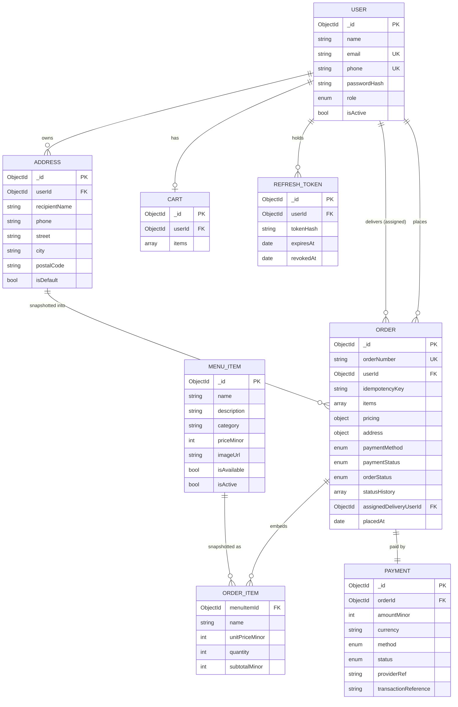
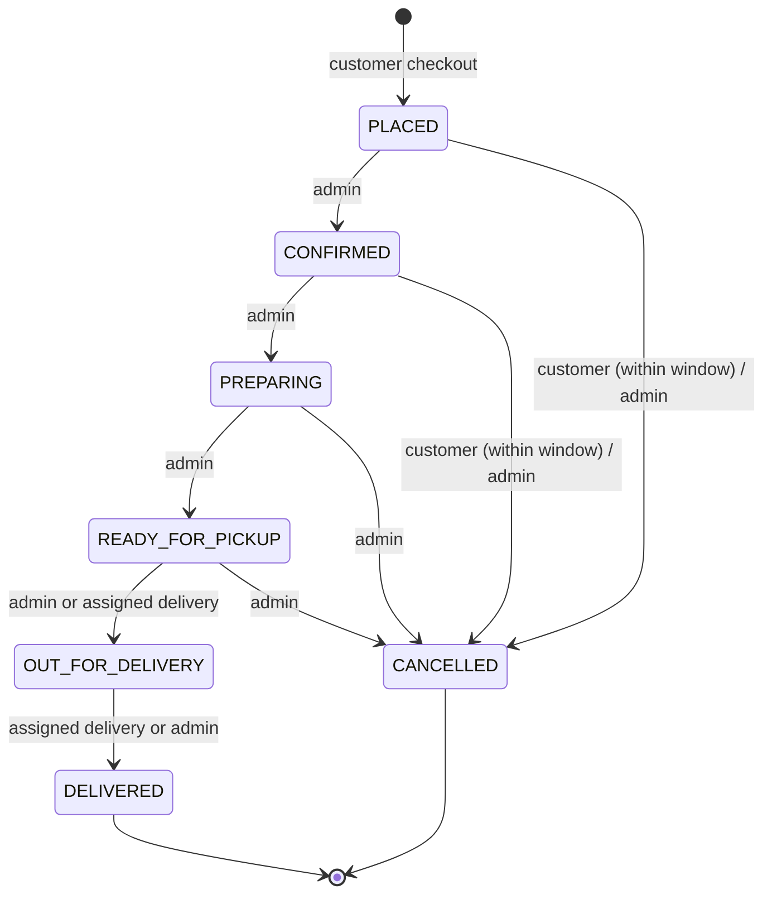
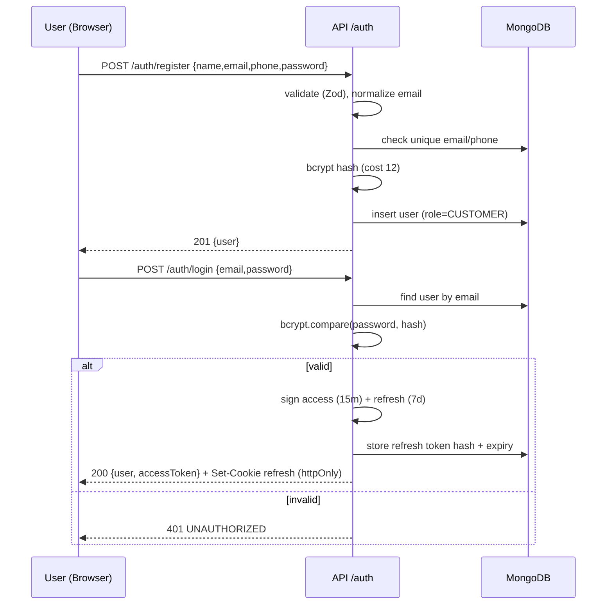
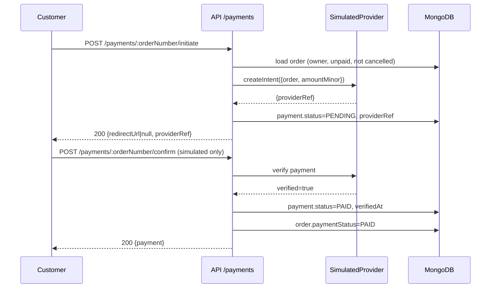

# Online Food Ordering System — System Architecture

> Source of truth: [`../guide/Online_Food_Ordering_System_SRS_Debopriya_Dey_Final.pdf`](../guide/Online_Food_Ordering_System_SRS_Debopriya_Dey_Final.pdf)
> SRS version 2.1 · 01/11/2026 · Course CSE11117 — Software Engineering · Adamas University
> This document refines the SRS conceptual models into a buildable architecture for an academic prototype.
> Companion document: [`ai-implementation-guide.md`](./ai-implementation-guide.md) — implementation guide for AI coding agents.

---

## 1. Purpose and Scope

This document describes the complete technical architecture of the **Online Food Ordering System (OFOS)**:
the stack, layers, modules, data model, API contracts, workflows, security model, deployment model,
and the traceability from SRS requirements to architectural components.

The system is a **web-based, single-restaurant food ordering platform** with three roles:

| Role | Capabilities |
|---|---|
| **Customer** | Register/login, browse/search menu, manage cart, checkout, pay (COD or simulated online), track orders, view history, manage profile and addresses |
| **Administrator** | Manage menu items and availability, view incoming orders, update order status, assign delivery, view basic reports |
| **Delivery Personnel** | View assigned deliveries, update pickup and delivery status |

Explicitly **out of scope** for the prototype (per SRS §1.4): multi-restaurant marketplace settlement,
route optimisation, loyalty programmes, live GPS navigation, production-grade payment settlement,
and real SMS/email notifications (in-app status only).

---

## 2. Architecture Drivers

### 2.1 Functional drivers
- FR-1.x Authentication and role-based access
- FR-2.x Menu browsing, category filter, search, availability
- FR-3.x Server-authoritative cart with quantity rules
- FR-4.x Order placement with server-side bill calculation and item snapshots
- FR-5.x COD + optional online payment with server-side verification
- FR-6.x Order status state machine with history and ownership rules
- FR-7.x Admin menu/order management and assignment
- FR-8.x Order history and profile/address isolation

### 2.2 Quality drivers
- **Correctness of money**: prices and totals must be computed server-side (BR-3) and never trusted from the client.
- **Traceability**: every order keeps a purchase-time snapshot of name, unit price, quantity, and subtotal.
- **Security**: hashed passwords, JWT auth, RBAC, ownership checks, validated input, no secrets in source.
- **Reliability**: no false success on checkout, no duplicate orders on double submit, atomic order writes.
- **Maintainability**: strict separation between routes, controllers, services, repositories, and models.
- **Performance**: page responses near 2 s under prototype load; pagination and indexes.
- **Portability**: modern browsers; runs locally and in Docker; MongoDB or containerised DB.

### 2.3 Constraints
- Academic prototype, single deployment, small team, limited time.
- MongoDB is selected (resolves TBD-01). A relational schema is documented as an alternative in §8.4.
- Online payments are simulated behind a provider adapter (TBD-02); COD is the guaranteed path.
- No microservices, no message broker, no real-time websockets required (polling suffices).

---

## 3. Technology Stack (Decision Record)

| Layer | Choice | Rationale |
|---|---|---|
| Frontend | **React 18 + Vite** | Component model matches SRS; fast dev server; SPA routing |
| Routing | **React Router 6** | Role-protected routes |
| Server state | **TanStack Query 5** | Caching, refetch, loading/error states with less boilerplate |
| HTTP client | **Fetch wrapper** (`src/api/client.js`) | No extra dependency; central auth/refresh/error handling |
| Styling | **CSS Modules + design tokens** | No UI framework lock-in; responsive and accessible |
| Backend | **Node.js 20 LTS + Express 4** | Matches SRS; mature middleware ecosystem |
| API style | **REST + JSON, versioned `/api/v1`** | Simple, testable, aligns with SRS interfaces |
| Validation | **Zod** | Schema validation shared across inputs; strips unknown fields |
| Database | **MongoDB 7 + Mongoose 8** | Document model fits embedded order snapshots; SRS reference |
| Auth | **JWT access token (15 min) + rotating refresh token (7 days, httpOnly cookie)** | Stateless access + revocable refresh |
| Password hashing | **bcrypt (cost 12)** | FR-1.2, NFR 5.3 |
| Logging | **pino + pino-http** | Structured logs, request IDs, redaction |
| Backend tests | **Vitest + Supertest + mongodb-memory-server** | Fast unit + integration tests |
| Frontend tests | **Vitest + React Testing Library** | Component and hook tests |
| E2E (optional) | **Playwright** | Happy-path ordering journey |
| Deployment | **Docker Compose** (client static build + API + MongoDB) or MongoDB Atlas | Reproducible local/prod |
| CI | **GitHub Actions** | Lint, test, build on push/PR |

**Language:** JavaScript (ES modules) throughout, matching the SRS. TypeScript is an acceptable
substitution, but if used it must be applied consistently across client and server.

---

## 4. High-Level Architecture

The system is a **three-tier, modular monolith**: a React SPA presentation tier, an Express
application tier, and a MongoDB data tier. All business rules live in the application tier.
The client is never trusted for prices, totals, availability, or status transitions.

```
┌──────────────────────────────────────────────────────────────────────────────┐
│                            PRESENTATION TIER (SPA)                           │
│  Browser: Chrome / Firefox / Edge / Safari                                   │
│  React 18 + Vite + React Router + TanStack Query + CSS Modules               │
│  ┌──────────┐ ┌──────────┐ ┌──────────┐ ┌──────────┐ ┌──────────┐ ┌────────┐  │
│  │  Auth    │ │  Menu    │ │  Cart    │ │ Checkout │ │  Orders  │ │ Admin/ │  │
│  │  Pages   │ │  Pages   │ │  Pages   │ │  Pages   │ │  + Track │ │Delivery│  │
│  └──────────┘ └──────────┘ └──────────┘ └──────────┘ └──────────┘ └────────┘  │
│         └──────────────────────── API client (fetch) ────────────────────────┘│
└───────────────────────────────────────┬──────────────────────────────────────┘
                                        │ HTTPS · JSON · Bearer JWT
                                        │ (refresh token in httpOnly cookie)
┌───────────────────────────────────────▼──────────────────────────────────────┐
│                          APPLICATION TIER (Node/Express)                     │
│  Middleware chain: requestId → helmet → cors → body parser → rate limit →    │
│                    auth → RBAC → validation → controller → error handler      │
│  ┌────────────────────────────────────────────────────────────────────────┐  │
│  │ Routes → Controllers → Services (business rules) → Repositories/Models │  │
│  └────────────────────────────────────────────────────────────────────────┘  │
│  Modules: auth · users · addresses · menu · cart · orders · payments ·       │
│           delivery · admin/reports · health                                  │
│  Cross-cutting: config, errors, money, pagination, order-number, idempotency │
└───────────────────────────────────────┬──────────────────────────────────────┘
                                        │ Mongoose ODM
┌───────────────────────────────────────▼──────────────────────────────────────┐
│                              DATA TIER (MongoDB)                             │
│  users · refresh_tokens · addresses · menu_items · carts · orders ·          │
│  payments · counters                                                         │
│  Indexes for login, menu search, order history, status and delivery queues   │
└──────────────────────────────────────────────────────────────────────────────┘

              Optional integrations (behind adapters, disabled by default)
              ┌───────────────────────┐   ┌──────────────────────────┐
              │ Payment Provider      │   │ Notification Provider    │
              │ (Simulated / Gateway) │   │ (out of scope for v1)    │
              └───────────────────────┘   └──────────────────────────┘
```

### 4.1 Why a modular monolith
- The SRS describes a small single-restaurant system; distributed services add cost without benefit.
- A single process keeps academic deployment simple and makes end-to-end tests straightforward.
- Modules are separated by folder and dependency direction, so extraction later is possible.

### 4.2 Dependency rule
```
routes ──► controllers ──► services ──► repositories ──► models
             │                 │
             └── validators    └── domain rules (pricing, transitions, authz)
```
- Controllers never touch Mongoose models directly.
- Services never read `req`/`res`.
- Models never contain business workflows (only schema, indexes, hooks).
- The client never calls the database or payment provider directly.

---

## 5. Frontend Architecture

### 5.1 Application shell
- Single Page Application served as static files.
- `AuthProvider` bootstraps the session (`GET /auth/me`) and exposes `user`, `login`, `logout`.
- `QueryClientProvider` manages all server state; mutations invalidate related queries.
- `ErrorBoundary` + global toast system for user-visible failures.
- Route guards:
  - `ProtectedRoute` — requires authentication.
  - `RoleRoute roles={[...]}` — requires one of the allowed roles; otherwise 403 page.

### 5.2 Route map

| Route | Access | Purpose |
|---|---|---|
| `/login` | Public | Login form (FOODIE branded, Figure 7) |
| `/register` | Public | Customer registration |
| `/` | Public/Customer | Menu landing with categories and search |
| `/cart` | Customer | Cart line items, quantities, subtotal |
| `/checkout` | Customer | Address, payment method, final bill, place order |
| `/orders` | Customer | Order history with pagination |
| `/orders/:orderNumber` | Customer (owner) | Order detail + status timeline |
| `/profile` | Customer | Profile and saved addresses |
| `/admin` | Admin | Dashboard / summary |
| `/admin/menu` | Admin | Menu CRUD + availability toggle |
| `/admin/orders` | Admin | Incoming orders, filter by status, update status, assign delivery |
| `/admin/reports` | Admin | Basic sales/order summary |
| `/delivery` | Delivery | Assigned deliveries |
| `/delivery/orders/:orderNumber` | Delivery (assigned) | Delivery detail and status updates |
| `*` | Public | 404 page |
| `/403` | Authenticated | Forbidden page |

### 5.3 Feature folder layout
```
client/
├── index.html
├── vite.config.js
├── .env.example                    # VITE_API_BASE_URL
└── src/
    ├── main.jsx
    ├── App.jsx                     # router + providers
    ├── api/
    │   ├── client.js               # fetch wrapper, auth header, 401 refresh, error mapping
    │   ├── auth.api.js
    │   ├── menu.api.js
    │   ├── cart.api.js
    │   ├── orders.api.js
    │   ├── payments.api.js
    │   ├── addresses.api.js
    │   ├── admin.api.js
    │   └── delivery.api.js
    ├── features/
    │   ├── auth/                   # LoginPage, RegisterPage, useAuth
    │   ├── menu/                   # MenuPage, CategoryTabs, MenuItemCard, SearchBar
    │   ├── cart/                   # CartPage, CartLine, useCart
    │   ├── checkout/               # CheckoutPage, AddressPicker, OrderSummary, PaymentSelector
    │   ├── orders/                 # OrdersPage, OrderDetailPage, StatusTimeline
    │   ├── profile/                # ProfilePage, AddressBook
    │   ├── admin/                  # AdminLayout, MenuManager, OrderBoard, Reports
    │   └── delivery/               # DeliveryBoard, DeliveryOrderDetail
    ├── components/
    │   ├── layout/                 # Header, Nav, Footer, PageShell
    │   └── ui/                     # Button, Input, Select, Modal, Toast, Spinner,
    │                               # EmptyState, ErrorState, Pagination, Badge, Money
    ├── context/
    │   ├── AuthContext.jsx
    │   └── ToastContext.jsx
    ├── hooks/                      # useDebounce, usePagination, useDocumentTitle
    ├── lib/
    │   ├── formatMoney.js          # minor units → display currency
    │   ├── constants.js            # roles, statuses, payment methods, routes
    │   ├── validators.js           # client-side form validation
    │   └── queryKeys.js            # stable TanStack Query keys
    ├── routes/
    │   ├── ProtectedRoute.jsx
    │   └── RoleRoute.jsx
    └── styles/
        ├── tokens.css              # colors, spacing, typography, breakpoints
        └── global.css
```

### 5.4 State management rules
- **Server state** (menu, cart, orders, profile) → TanStack Query. No duplicate copies in context.
- **Auth state** → `AuthContext` (user object + tokens in memory; refresh cookie is httpOnly).
- **Ephemeral UI state** (modals, form fields) → local component state.
- **Cart** is server-backed and keyed by the authenticated user; mutations refetch/invalidate `['cart']`.
- Money is always handled as an integer in **minor units**; format only at render time.

### 5.5 UX requirements
- Responsive: mobile-first, breakpoints at 480 / 768 / 1024 / 1280 px.
- Loading states for every query; optimistic updates only for cart quantity (with rollback).
- Clear validation messages tied to fields; disable submit while pending.
- Order status shown with a timestamped timeline and human-readable labels.
- Unavailable items are visibly disabled and cannot be added (FR-2.3).
- Accessibility: semantic landmarks, labelled inputs, visible focus, keyboard-operable dialogs,
  contrast ≥ 4.5:1 for text (SRS §5.4).

---

## 6. Backend Architecture

### 6.1 Module map

| Module | Responsibility | Key services |
|---|---|---|
| `auth` | Register, login, refresh, logout, current user | `authService` |
| `users` | Profile read/update | `userService` |
| `addresses` | Customer address CRUD with ownership | `addressService` |
| `menu` | List/search/filter, admin CRUD, availability | `menuService` |
| `cart` | Get/add/update/remove/clear, availability revalidation | `cartService` |
| `orders` | Create order, pricing, list, detail, cancel, status transitions, assignment | `orderService`, `pricingService`, `orderStatusService` |
| `payments` | COD/online initiation, verification, webhook, refund record | `paymentService`, `PaymentProvider` |
| `delivery` | Assigned queue and delivery status updates | reuses `orderService` with delivery guard |
| `admin` | Reports/summary, user listing (minimal) | `reportService` |
| `health` | Liveness and readiness | — |

### 6.2 Server folder layout
```
server/
├── package.json
├── .env.example
├── src/
│   ├── server.js                   # process bootstrap, graceful shutdown
│   ├── app.js                      # express app, middleware, route mounting
│   ├── config/
│   │   ├── env.js                  # schema-validated environment loader
│   │   ├── db.js                   # mongoose connect/disconnect
│   │   └── constants.js            # roles, statuses, payment methods, transitions
│   ├── routes/
│   │   ├── index.js
│   │   ├── auth.routes.js
│   │   ├── user.routes.js
│   │   ├── address.routes.js
│   │   ├── menu.routes.js
│   │   ├── cart.routes.js
│   │   ├── order.routes.js
│   │   ├── payment.routes.js
│   │   ├── admin.routes.js
│   │   └── delivery.routes.js
│   ├── controllers/
│   ├── services/
│   │   ├── auth.service.js
│   │   ├── user.service.js
│   │   ├── address.service.js
│   │   ├── menu.service.js
│   │   ├── cart.service.js
│   │   ├── pricing.service.js
│   │   ├── order.service.js
│   │   ├── order-status.service.js
│   │   ├── payment.service.js
│   │   ├── report.service.js
│   │   └── providers/
│   │       ├── payment-provider.js        # interface / contract
│   │       ├── simulated.provider.js
│   │       └── gateway.provider.js        # stub for future real gateway
│   ├── repositories/
│   │   ├── user.repo.js
│   │   ├── refresh-token.repo.js
│   │   ├── address.repo.js
│   │   ├── menu.repo.js
│   │   ├── cart.repo.js
│   │   ├── order.repo.js
│   │   ├── payment.repo.js
│   │   └── counter.repo.js
│   ├── models/
│   │   ├── user.model.js
│   │   ├── refresh-token.model.js
│   │   ├── address.model.js
│   │   ├── menu-item.model.js
│   │   ├── cart.model.js
│   │   ├── order.model.js
│   │   ├── payment.model.js
│   │   └── counter.model.js
│   ├── validators/
│   │   ├── auth.validator.js
│   │   ├── address.validator.js
│   │   ├── menu.validator.js
│   │   ├── cart.validator.js
│   │   ├── order.validator.js
│   │   └── common.validator.js    # objectId, pagination, phone, money
│   ├── middleware/
│   │   ├── authenticate.js
│   │   ├── authorize.js           # role guard
│   │   ├── validate.js            # body/query/params
│   │   ├── idempotency.js
│   │   ├── error-handler.js
│   │   ├── not-found.js
│   │   ├── rate-limit.js
│   │   └── request-id.js
│   ├── utils/
│   │   ├── ApiError.js
│   │   ├── async-handler.js
│   │   ├── money.js               # minor-unit math, rounding guards
│   │   ├── order-number.js
│   │   ├── pagination.js
│   │   ├── tokens.js              # sign/verify access + refresh
│   │   └── logger.js
│   └── tests/
│       ├── helpers/
│       │   ├── test-db.js
│       │   └── factories.js
│       ├── integration/
│       └── unit/
└── scripts/
    └── seed.js                    # demo admin, delivery user, menu items
```

### 6.3 Request lifecycle
1. `requestId` assigns/propagates `x-request-id`.
2. `helmet` sets security headers.
3. `cors` allows only configured origins with credentials.
4. `express.json({ limit: '100kb' })` parses JSON.
5. Rate limiter applies per route class (auth stricter).
6. `authenticate` verifies Bearer JWT and loads `{ id, role }`.
7. `authorize(...roles)` enforces coarse RBAC.
8. `validate({ body, query, params })` parses Zod schemas; unknown keys stripped.
9. Controller calls a service and returns the standard envelope.
10. `error-handler` maps `ApiError` and known Mongo errors to consistent responses.
11. `not-found` handles unknown routes.

### 6.4 API response envelope

Success:
```json
{
  "success": true,
  "data": { "...": "..." },
  "meta": { "page": 1, "limit": 20, "total": 42, "totalPages": 3 }
}
```
Error:
```json
{
  "success": false,
  "error": {
    "code": "VALIDATION_ERROR",
    "message": "Quantity must be a positive integer",
    "details": [{ "path": "quantity", "message": "Must be >= 1" }]
  }
}
```
- 204 responses have no body.
- `meta` is only present on paginated lists.
- Never leak stack traces or DB internals in production.

### 6.5 Error codes

| HTTP | Code | When |
|---|---|---|
| 400 | `VALIDATION_ERROR` | Zod/schema failure |
| 401 | `UNAUTHORIZED` | Missing/invalid/expired token |
| 403 | `FORBIDDEN` | Role or ownership violation |
| 404 | `NOT_FOUND` | Resource missing or not visible to caller |
| 409 | `CONFLICT` | Duplicate email, duplicate idempotency key with different payload, invalid status transition |
| 409 | `ITEM_UNAVAILABLE` | Item deactivated/unavailable at checkout/add |
| 409 | `CART_EMPTY` | Checkout with empty cart |
| 409 | `INVALID_STATUS_TRANSITION` | Status change not allowed |
| 409 | `CANCELLATION_NOT_ALLOWED` | Outside cancellation window/state |
| 422 | `PAYMENT_FAILED` | Provider declined/failed |
| 429 | `RATE_LIMITED` | Limiter triggered |
| 500 | `INTERNAL_ERROR` | Unhandled server error |

---

## 7. API Design (v1)

Base URL: `/api/v1`. All authenticated endpoints require `Authorization: Bearer <accessToken>`.
`AUTH` column: Public / Customer / Admin / Delivery / Any authenticated.

### 7.1 Auth
| Method | Path | Auth | Description |
|---|---|---|---|
| POST | `/auth/register` | Public | Register customer (name, email, phone, password) |
| POST | `/auth/login` | Public | Verify credentials, return access token + set refresh cookie |
| POST | `/auth/refresh` | Refresh cookie | Rotate refresh token, return new access token |
| POST | `/auth/logout` | Any auth | Revoke current refresh token, clear cookie |
| GET | `/auth/me` | Any auth | Current user profile |

Register request:
```json
{ "name": "Debopriya Dey", "email": "debopriya@example.com", "phone": "+919876543210", "password": "S3curePass!" }
```
Login request:
```json
{ "email": "debopriya@example.com", "password": "S3curePass!" }
```
Auth response:
```json
{
  "success": true,
  "data": {
    "user": { "id": "...", "name": "Debopriya Dey", "email": "...", "role": "CUSTOMER" },
    "accessToken": "..."
  }
}
```
Refresh token is set as `HttpOnly; Secure (prod); SameSite=Lax; Path=/api/v1/auth`.

### 7.2 Users and addresses
| Method | Path | Auth | Description |
|---|---|---|---|
| GET | `/users/me` | Any auth | Profile |
| PATCH | `/users/me` | Any auth | Update name/phone |
| GET | `/addresses` | Customer | List own addresses |
| POST | `/addresses` | Customer | Create address |
| PATCH | `/addresses/:id` | Customer (owner) | Update address |
| DELETE | `/addresses/:id` | Customer (owner) | Delete address |

### 7.3 Menu
| Method | Path | Auth | Description |
|---|---|---|---|
| GET | `/menu` | Public | Paginated menu; filters: `category`, `q`, `available`, `page`, `limit` |
| GET | `/menu/categories` | Public | Distinct active categories |
| GET | `/menu/:id` | Public | Single item |
| POST | `/menu` | Admin | Create item |
| PATCH | `/menu/:id` | Admin | Update item |
| DELETE | `/menu/:id` | Admin | Soft-deactivate item |
| PATCH | `/menu/:id/availability` | Admin | Toggle availability |

Menu item payload:
```json
{
  "name": "Paneer Butter Masala",
  "description": "Creamy tomato gravy with cottage cheese",
  "category": "Main Course",
  "priceMinor": 28000,
  "imageUrl": "https://...",
  "isAvailable": true
}
```
`priceMinor` is an integer in minor currency units (paise). 28,000 → ₹280.00.

### 7.4 Cart
| Method | Path | Auth | Description |
|---|---|---|---|
| GET | `/cart` | Customer | Cart with live item details and computed subtotal |
| POST | `/cart/items` | Customer | Add `{ menuItemId, quantity }` (merge if present) |
| PATCH | `/cart/items/:menuItemId` | Customer | Set quantity (1–99) |
| DELETE | `/cart/items/:menuItemId` | Customer | Remove line |
| DELETE | `/cart` | Customer | Clear cart |

Cart response includes per-line `name`, `priceMinor`, `quantity`, `subtotalMinor`, `isAvailable`,
plus `subtotalMinor`, `itemCount`. Unavailable lines are flagged and **excluded from order totals**
with an explicit warning; checkout rejects them (BR-2).

### 7.5 Orders
| Method | Path | Auth | Description |
|---|---|---|---|
| POST | `/orders` | Customer | Create order from cart (requires `Idempotency-Key` header) |
| GET | `/orders` | Customer | Own orders, paginated, newest first |
| GET | `/orders/:orderNumber` | Customer (owner) / Admin / Assigned delivery | Order detail |
| POST | `/orders/:orderNumber/cancel` | Customer (owner) / Admin | Cancel per policy |
| PATCH | `/orders/:orderNumber/status` | Admin / Assigned delivery | Transition status |
| PATCH | `/orders/:orderNumber/assign` | Admin | Assign delivery user |
| GET | `/delivery/orders` | Delivery | Assigned orders, filter by status |

Create order request (address snapshot may be inline or referenced by `addressId`):
```json
{
  "addressId": "665f...",
  "paymentMethod": "COD",
  "notes": "Ring the bell"
}
```
Header: `Idempotency-Key: 7c9e6679-7425-40de-944b-e07fc1f90ae7`

Order response (shape):
```json
{
  "success": true,
  "data": {
    "orderNumber": "ORD-20261102-0001",
    "orderStatus": "PLACED",
    "paymentMethod": "COD",
    "paymentStatus": "PENDING",
    "items": [
      { "menuItemId": "...", "name": "Paneer Butter Masala", "unitPriceMinor": 28000, "quantity": 2, "subtotalMinor": 56000 }
    ],
    "pricing": { "subtotalMinor": 56000, "deliveryFeeMinor": 3000, "taxMinor": 0, "discountMinor": 0, "totalMinor": 59000 },
    "address": { "recipientName": "Debopriya Dey", "phone": "+91...", "street": "...", "city": "...", "postalCode": "..." },
    "statusHistory": [{ "status": "PLACED", "changedAt": "2026-11-02T10:15:00.000Z", "changedBy": "..." }],
    "placedAt": "2026-11-02T10:15:00.000Z"
  }
}
```

Status transition request:
```json
{ "status": "CONFIRMED", "note": "Payment verified" }
```

### 7.6 Payments
| Method | Path | Auth | Description |
|---|---|---|---|
| POST | `/payments/:orderNumber/initiate` | Customer (owner) | Start online payment; returns provider intent/redirect info |
| POST | `/payments/:orderNumber/confirm` | Customer (owner) | Prototype-only simulated confirmation (guarded by `PAYMENT_MODE=simulated`) |
| POST | `/payments/webhook` | Provider signature | Real gateway callback; verifies signature before updating |
| GET | `/payments/:orderNumber` | Customer (owner) / Admin | Payment record |

Payment adapter contract:
```js
// PaymentProvider
createIntent({ order, amountMinor, currency, customer }) -> { providerRef, redirectUrl? }
verifyWebhook({ headers, rawBody }) -> { verified, providerRef, status, amountMinor }
refund({ providerRef, amountMinor }) -> { status, refundRef }
```
`SimulatedProvider` marks `initiate` as `PENDING` and `confirm` as `PAID` without external calls.
Only the server may mark a payment `PAID` after verification (FR-5.3).

### 7.7 Admin and reports
| Method | Path | Auth | Description |
|---|---|---|---|
| GET | `/admin/orders` | Admin | All orders; filters: `status`, `from`, `to`, `q`, pagination |
| GET | `/admin/reports/summary` | Admin | Totals: orders by status, revenue (paid), top items |
| GET | `/admin/users` | Admin | Minimal user list (for delivery assignment, role filter) |

### 7.8 Health
| Method | Path | Auth | Description |
|---|---|---|---|
| GET | `/health` | Public | Liveness `{ status: "ok", uptime }` |
| GET | `/health/ready` | Public | Mongo ping + config readiness |

### 7.9 Pagination, filtering, sorting
- `?page=1&limit=20`; default 20, max 100. Response `meta` carries totals.
- Menu search: case-insensitive regex/`$text` on name and description (escaped input).
- Orders sortable by `placedAt` desc (fixed for customers); admin may filter by status/date.
- Date filters accept ISO-8601 and are validated.

### 7.10 Idempotency
- Checkout requires an `Idempotency-Key` (UUID v4) generated per checkout attempt.
- Stored on the order as `{ userId, idempotencyKey }` with a unique partial index.
- Repeated request with the same key returns the **existing** order (HTTP 200) rather than creating a duplicate.
- Same key with different payload → `409 CONFLICT`.

---

## 8. Data Architecture

### 8.1 Modeling strategy
- **Orders embed item snapshots and status history.** This guarantees historical bills (FR-4.4) and makes
  order creation a single-document atomic write.
- **References** are used for user → addresses, user → cart, order → payment, order → assigned delivery user.
- **Carts embed line items**; prices are never stored in the cart — they are resolved live at read/checkout.
- **Menu items are soft-deleted** (`isActive=false`) so historical orders retain valid references.

### 8.2 Collections, fields, and indexes

#### `users`
| Field | Type | Notes |
|---|---|---|
| `_id` | ObjectId | PK |
| `name` | string | 2–80 chars, trimmed |
| `email` | string | lowercase, unique, indexed; login identifier |
| `phone` | string | E.164-ish, unique sparse index |
| `passwordHash` | string | bcrypt; never returned by API |
| `role` | enum | `CUSTOMER` \| `ADMIN` \| `DELIVERY` |
| `isActive` | boolean | default true |
| `createdAt`, `updatedAt` | date | timestamps |
Indexes: `{ email: 1 } unique`, `{ phone: 1 } unique sparse`, `{ role: 1, isActive: 1 }`.

#### `refresh_tokens`
| Field | Type | Notes |
|---|---|---|
| `_id` | ObjectId | PK |
| `userId` | ObjectId ref users | indexed |
| `tokenHash` | string | SHA-256 of refresh token; unique |
| `expiresAt` | date | TTL index `{ expiresAt: 1 }, expireAfterSeconds: 0` |
| `revokedAt` | date | null unless rotated/revoked |
| `createdByIp`, `userAgent` | string | optional audit |
Indexes: `{ tokenHash: 1 } unique`, `{ userId: 1 }`, TTL on `expiresAt`.

#### `addresses`
| Field | Type | Notes |
|---|---|---|
| `_id` | ObjectId | PK |
| `userId` | ObjectId ref users | indexed |
| `recipientName` | string | required |
| `phone` | string | required |
| `street` | string | required |
| `city` | string | required |
| `postalCode` | string | required |
| `isDefault` | boolean | at most one default per user (service-enforced) |
Index: `{ userId: 1, isDefault: -1 }`.

#### `menu_items`
| Field | Type | Notes |
|---|---|---|
| `_id` | ObjectId | PK |
| `name` | string | indexed for search |
| `description` | string | |
| `category` | string | indexed |
| `priceMinor` | integer | ≥ 0, minor units |
| `imageUrl` | string | URL or local asset path |
| `isAvailable` | boolean | can be added to cart |
| `isActive` | boolean | soft-delete; hidden from customers |
| `createdBy` | ObjectId ref users | admin |
| `createdAt`, `updatedAt` | date | |
Indexes: `{ category: 1, isAvailable: 1, isActive: 1 }`, `{ name: "text", description: "text" }`.

#### `carts`
| Field | Type | Notes |
|---|---|---|
| `_id` | ObjectId | PK |
| `userId` | ObjectId ref users | unique |
| `items` | array | `{ menuItemId, quantity, addedAt }` |
| `updatedAt` | date | |
Index: `{ userId: 1 } unique`.

#### `orders`
| Field | Type | Notes |
|---|---|---|
| `_id` | ObjectId | PK |
| `orderNumber` | string | unique, human-readable |
| `userId` | ObjectId ref users | indexed |
| `idempotencyKey` | string | unique per user (partial) |
| `items` | array | snapshot: `{ menuItemId, name, unitPriceMinor, quantity, subtotalMinor }` |
| `pricing` | object | `{ subtotalMinor, deliveryFeeMinor, taxMinor, discountMinor, totalMinor }` |
| `address` | object | snapshot: `{ recipientName, phone, street, city, postalCode }` |
| `addressId` | ObjectId ref addresses | optional source reference |
| `paymentMethod` | enum | `COD` \| `ONLINE` |
| `paymentStatus` | enum | `PENDING` \| `PAID` \| `FAILED` \| `REFUNDED` \| `CANCELLED` |
| `orderStatus` | enum | see §9 |
| `statusHistory` | array | `{ status, changedBy, changedByRole, changedAt, note? }` |
| `assignedDeliveryUserId` | ObjectId ref users | nullable |
| `notes` | string | customer instructions, max 300 |
| `cancellation` | object | `{ cancelledBy, reason, cancelledAt }` optional |
| `placedAt` | date | set on creation |
| `createdAt`, `updatedAt` | date | |
Indexes:
- `{ orderNumber: 1 } unique`
- `{ userId: 1, placedAt: -1 }`
- `{ orderStatus: 1, placedAt: -1 }`
- `{ assignedDeliveryUserId: 1, orderStatus: 1 }`
- `{ userId: 1, idempotencyKey: 1 }` unique, partial `{ idempotencyKey: { $exists: true } }`

#### `payments`
| Field | Type | Notes |
|---|---|---|
| `_id` | ObjectId | PK |
| `orderId` | ObjectId ref orders | indexed |
| `orderNumber` | string | denormalised for lookups |
| `userId` | ObjectId ref users | indexed |
| `method` | enum | `COD` \| `ONLINE` |
| `amountMinor` | integer | must equal order total |
| `currency` | string | `INR` (configurable) |
| `status` | enum | `PENDING` \| `PAID` \| `FAILED` \| `REFUNDED` \| `CANCELLED` |
| `provider` | string | `SIMULATED` \| gateway name |
| `providerRef` | string | intent/reference from provider |
| `transactionReference` | string | unique sparse |
| `failureReason` | string | optional |
| `verifiedAt` | date | set only after server verification |
| `createdAt`, `updatedAt` | date | |
Indexes: `{ orderId: 1 }`, `{ transactionReference: 1 } unique sparse`, `{ userId: 1, createdAt: -1 }`.

#### `counters`
| Field | Type | Notes |
|---|---|---|
| `_id` | string | e.g. `order-20261102` |
| `seq` | integer | atomic `$inc` |
Used only to generate `ORD-YYYYMMDD-NNNN`.

### 8.3 Entity relationships



> `ORDER_ITEM` is an embedded subdocument, not a separate collection. It is shown separately
> to make the snapshot relationship explicit.

### 8.4 Relational alternative (only if MongoDB is rejected)
```sql
users(id PK, name, email UNIQUE, phone UNIQUE, password_hash, role, is_active, created_at, updated_at)
addresses(id PK, user_id FK, recipient_name, phone, street, city, postal_code, is_default)
menu_items(id PK, name, description, category, price_minor, image_url, is_available, is_active, created_at, updated_at)
carts(id PK, user_id FK UNIQUE, updated_at)
cart_items(id PK, cart_id FK, menu_item_id FK, quantity)
orders(id PK, order_number UNIQUE, user_id FK, address_snapshot JSONB, payment_method, payment_status,
       order_status, assigned_delivery_user_id FK, notes, placed_at, created_at, updated_at)
order_items(id PK, order_id FK, menu_item_id FK, name_snapshot, unit_price_minor, quantity, subtotal_minor)
order_status_history(id PK, order_id FK, status, changed_by FK, changed_at, note)
payments(id PK, order_id FK, amount_minor, currency, method, status, provider_ref, transaction_reference UNIQUE,
         verified_at, created_at, updated_at)
refresh_tokens(id PK, user_id FK, token_hash UNIQUE, expires_at, revoked_at)
```
Use `NUMERIC(12,0)` (or `BIGINT`) for minor units. Wrap checkout in a transaction.

### 8.5 Data integrity rules
- Unique email and phone; `passwordHash` never returned.
- Order must belong to exactly one customer and contain ≥ 1 item (FR-4.1).
- Order items preserve purchase-time `name` and `unitPriceMinor` (FR-4.4, SRS §6.3).
- `payments.amountMinor` must equal `orders.pricing.totalMinor` at verification time.
- Quantity is an integer in `[1, 99]`; line subtotal is `quantity × unitPriceMinor`.
- No orphan records: addresses/carts/payments reference an existing user/order.
- Soft-delete menu items; never hard-delete records referenced by orders.
- Status changes append to `statusHistory`; never overwrite history.
- Money uses integers only; no floating-point arithmetic.

---

## 9. Order and Payment State Machines

### 9.1 Order statuses
`PLACED` → `CONFIRMED` → `PREPARING` → `READY_FOR_PICKUP` → `OUT_FOR_DELIVERY` → `DELIVERED`
plus terminal `CANCELLED`.



### 9.2 Transition authorization matrix

| From | To | Allowed actor | Guard |
|---|---|---|---|
| `PLACED` | `CONFIRMED` | Admin | — |
| `PLACED` | `CANCELLED` | Customer (owner), Admin | Customer: within `CANCELLATION_WINDOW_MINUTES` (default 10) |
| `CONFIRMED` | `PREPARING` | Admin | — |
| `CONFIRMED` | `CANCELLED` | Customer (owner), Admin | Customer: within cancellation window |
| `PREPARING` | `READY_FOR_PICKUP` | Admin | — |
| `PREPARING` | `CANCELLED` | Admin | — |
| `READY_FOR_PICKUP` | `OUT_FOR_DELIVERY` | Admin, Assigned delivery | Order must be assigned to that delivery user if actor is delivery |
| `READY_FOR_PICKUP` | `CANCELLED` | Admin | — |
| `OUT_FOR_DELIVERY` | `DELIVERED` | Admin, Assigned delivery | — |
| `DELIVERED` | — | — | Terminal; no further transitions |
| `CANCELLED` | — | — | Terminal |

Additional rules:
- BR-4: `DELIVERED` can only follow `OUT_FOR_DELIVERY`; enforced by the matrix.
- BR-5: only admin or the assigned delivery user can change operational statuses.
- BR-6: customer cancellation only in `PLACED`/`CONFIRMED` within the window.
- Every transition uses an atomic compare-and-set:
  `updateOne({ _id, orderStatus: from }, { $set: { orderStatus: to }, $push: { statusHistory: entry } })`.
  If `modifiedCount === 0`, return `409 INVALID_STATUS_TRANSITION` (a concurrent update won).
- If an order is `PAID` and gets cancelled, payment becomes `REFUNDED` (simulated refund) or
  a refund is recorded for later processing.

### 9.3 Payment statuses
`PENDING` → `PAID` | `FAILED` | `CANCELLED`
`PAID` → `REFUNDED`

| Method | Flow |
|---|---|
| `COD` | Payment created `PENDING` at order placement; set `PAID` when order becomes `DELIVERED` (cash collected), or `CANCELLED` if order cancelled before delivery |
| `ONLINE` (simulated) | Order placed with `PENDING`; `/payments/:orderNumber/initiate` → `PENDING`; `/confirm` → `PAID`; failures → `FAILED` and order remains unpaid |
| `ONLINE` (real gateway, future) | `initiate` returns redirect; webhook verifies signature and amount; only then `PAID` |

Payment invariants:
- FR-5.3: only server-side verification sets `PAID`.
- FR-5.4: failed/cancelled payments are recorded and never mark the order paid.
- A paid order cannot be marked `FAILED`.
- `transactionReference` is unique when present.

---

## 10. Key Workflows

### 10.1 Registration and login


Token handling:
- Access token: signed JWT with `{ sub, role }`, 15-minute expiry, sent as Bearer.
- Refresh token: opaque/JWT, 7 days, stored hashed in `refresh_tokens`, rotated on every refresh.
- Logout revokes the presented refresh token and clears the cookie.
- On `401`, the client attempts one `/auth/refresh`; if it fails, it clears auth state and redirects to `/login`.

### 10.2 Menu browsing
1. `GET /menu?category=&q=&page=1&limit=20`.
2. Server filters `isActive=true`; customers additionally see `isAvailable` flags.
3. Results are projected (no internal fields) and paginated.
4. Category list derived from distinct active categories.
5. Unavailable items render disabled and cannot be added (FR-2.3).

### 10.3 Cart management
1. `POST /cart/items` validates the item is active and available; quantity 1–99.
2. Existing line → quantity incremented (capped at 99).
3. `GET /cart` joins live menu data; if an item became unavailable, it is flagged.
4. Mutations return the recomputed cart; client invalidates cache.
5. Cart persists per user in MongoDB (FR-3.4, session-surviving).

### 10.4 Checkout and order creation
```mermaid
sequenceDiagram
    participant C as Customer (SPA)
    participant A as API /orders
    participant P as PricingService
    participant D as MongoDB
    C->>A: POST /orders {addressId, paymentMethod}<br/>Idempotency-Key
    A->>A: authenticate + validate
    A->>D: find order by (userId, idempotencyKey)
    alt existing order
        D-->>A: order
        A-->>C: 200 existing order
    else new
        A->>D: load cart (must be non-empty)
        A->>D: load menu items (active + available)
        A->>P: compute subtotal, delivery fee, tax, discount, total
        P-->>A: pricing (integer minor units)
        A->>D: load + verify address ownership, snapshot
        A->>D: atomic counter $inc → orderNumber
        A->>D: insert order (PLACED, statusHistory, item snapshots)
        A->>D: insert payment (PENDING)
        A->>D: clear cart
        A-->>C: 201 {order}
    end
    Note over A,D: On a replica set, wrap order+payment+cart-clear in a transaction.<br/>On standalone, the order document is atomic and authoritative; payment<br/>creation is idempotent and cart is cleared after success.
```

Server-side pricing (FR-4.2, BR-3):
```
subtotal   = Σ (item.priceMinor × quantity)
delivery   = DELIVERY_FEE_MINOR (config; 0 if subtotal ≥ FREE_DELIVERY_THRESHOLD_MINOR)
tax        = round(subtotal × TAX_RATE_BPS / 10000)
discount   = 0 (prototype; hook reserved)
total      = subtotal + delivery + tax − discount
```
All arithmetic uses integers and explicit rounding helpers. Client-submitted totals are ignored.

### 10.5 Online payment (simulated)

With a real gateway, `/confirm` is replaced by `/payments/webhook`, which verifies the signature
and amount before updating records. Browser redirects are never trusted as proof of payment.

### 10.6 Status update and assignment
1. Admin/delivery sends `PATCH /orders/:orderNumber/status { status, note }`.
2. Service validates actor rights, current state, and transition matrix.
3. Atomic compare-and-set updates `orderStatus` and appends `statusHistory`.
4. If the new status is `DELIVERED` and method is `COD`, set payment `PAID`.
5. Admin can `PATCH /orders/:orderNumber/assign { deliveryUserId }`; the target must have role `DELIVERY`.
6. Delivery users only see and mutate orders assigned to them.

### 10.7 Cancellation
- Customer: only owner, status in `{PLACED, CONFIRMED}`, within window (default 10 minutes of `placedAt`).
- Admin: any non-terminal state up to `READY_FOR_PICKUP` (not after dispatch).
- Cancel appends `statusHistory`, sets `cancellation`, and:
  - COD → payment `CANCELLED`
  - PAID online → payment `REFUNDED` (simulated) and refund reference recorded.

---

## 11. Security Architecture

### 11.1 Authentication
- bcrypt cost 12 for passwords; never log or return hashes.
- Access JWT signed with `JWT_ACCESS_SECRET`, 15-minute lifetime.
- Refresh token rotated on use; stored only as a SHA-256 hash; TTL-indexed; revocable.
- Cookie: `HttpOnly`, `SameSite=Lax`, `Secure` in production, `Path=/api/v1/auth`.
- Password minimum policy: ≥ 8 chars, at least one letter and one digit (client + server).

### 11.2 Authorization (RBAC + ownership)
| Capability | Customer | Admin | Delivery |
|---|---|---|---|
| Browse menu | ✓ | ✓ | ✓ |
| Manage own cart | ✓ | — | — |
| Place/cancel own order | ✓ | ✓ (cancel) | — |
| View own order | ✓ | ✓ | — |
| View all orders | — | ✓ | — |
| View assigned orders | — | ✓ | ✓ |
| Update order status | — | ✓ | ✓ (assigned, delivery transitions) |
| Assign delivery | — | ✓ | — |
| Manage menu | — | ✓ | — |
| Manage own profile/address | ✓ | — | — |
| Reports | — | ✓ | — |

Ownership checks are enforced **in services/repositories**, not only in UI. A resource that exists but
is not visible to the caller returns `404` (avoid leaking existence) or `403` when the role is wrong.

### 11.3 Input and output safety
- Validate all body/query/params with Zod; reject unknown keys; coerce and bound numbers.
- Escape regex input for search; use parameterised Mongoose queries (no string interpolation).
- Limit request body to 100 KB; cap strings (name 80, description 500, notes 300).
- `helmet` security headers; disable `x-powered-by`.
- CORS allowlist from `CORS_ORIGINS`; credentials enabled only for those origins.
- Rate limits: auth `10 / 15 min / IP`; writes `60 / 15 min / user`; reads `300 / 15 min / user`.
- Error responses never include stack traces, DB errors, or secrets in production.
- Validate `ObjectId` params before querying to avoid cast errors leaking.

### 11.4 Secrets and configuration
- All secrets from environment variables; `.env` is git-ignored; `.env.example` is committed.
- `config/env.js` validates required variables at boot and fails fast with a clear message.
- Never hard-code payment keys, DB URIs, or JWT secrets (SRS §2.5).
- Redact `authorization`, `cookie`, `password`, `passwordHash`, and payment payloads in logs.

### 11.5 OWASP Top 10 coverage (prototype)
| Risk | Mitigation |
|---|---|
| Broken access control | RBAC middleware + ownership checks + 404-on-non-owned |
| Cryptographic failures | bcrypt, HTTPS, hashed refresh tokens, no secrets in source |
| Injection | Zod validation, Mongoose parameterisation, escaped regex |
| Insecure design | Explicit state machines, server-authoritative totals, idempotency |
| Security misconfiguration | helmet, CORS allowlist, env validation, production error masking |
| Vulnerable components | Pinned dependencies, `npm audit` in CI |
| Auth failures | Strong hashing, rate limiting, short-lived tokens, refresh rotation |
| Data integrity failures | Schema validation, unique indexes, atomic transitions |
| Logging failures | Structured logs with redaction; audit status changes |
| SSRF | No user-supplied URLs fetched server-side; image URLs are validated or allowlisted |

### 11.6 Privacy
- Collect only data needed for auth, fulfilment, and payment (SRS §6.4).
- Addresses/phones visible to the owner, admins, and the assigned delivery user only.
- Provide account/profile data minimization; no third-party analytics in the prototype.
- Logs retain no full addresses or payment payloads; use IDs.

---

## 12. Non-Functional Architecture

### 12.1 Performance
- Indexes cover login (`email`), menu filters (`category`, availability), order history (`userId+placedAt`),
  status queues (`orderStatus+placedAt`), deliveries (`assignedDeliveryUserId+orderStatus`).
- Default page size 20, max 100; `lean()` reads and field projections.
- Client caching via TanStack Query (`staleTime` 30 s for menu; invalidation on mutations).
- Optional in-memory category cache (60 s TTL) invalidated on menu mutations.
- Target: p95 < 2 s for menu and order-history requests under prototype load.
- Visible loading/skeleton states; mutations disable submit while pending.

### 12.2 Reliability and consistency
- Order creation is a single-document atomic write; payments are idempotent and reconcilable.
- Checkout is idempotent via `Idempotency-Key`; double submits return the same order.
- Status transitions use atomic compare-and-set to prevent lost updates.
- No false success: only respond 201 after the order is persisted; errors map to explicit codes.
- Health endpoints and graceful shutdown (`SIGTERM` → stop accepting → close DB).
- Backup: `mongodump` schedule or Atlas snapshots; documented restore procedure.

### 12.3 Maintainability
- Layered modules with one-directional dependencies.
- Shared constants for roles/statuses/methods; no magic strings.
- Zod schemas per module; DTO mappers keep internal fields out of responses.
- Consistent response envelope and error codes.
- Tests colocated by module; factories for fixtures.

### 12.4 Usability, accessibility, portability
- Mobile-first responsive layout; minimum 44 px touch targets.
- WCAG 2.1 AA intent: labels, focus rings, keyboard dialogs, contrast, alt text.
- Modern browsers only (Chrome, Firefox, Edge, Safari), ES2020+.
- Runs on Windows/macOS/Linux via Node + Docker; no native OS dependencies.

---

## 13. Deployment Architecture

### 13.1 Local development
```
┌──────────────┐      proxy /api      ┌─────────────────┐      ┌──────────────┐
│ Vite dev     │ ───────────────────► │ Express :5000   │ ───► │ MongoDB :27017│
│ :5173        │                      │                 │      │ (Docker)      │
└──────────────┘                      └─────────────────┘      └──────────────┘
```
- `client`: `npm run dev` (Vite proxy `/api` → `http://localhost:5000`).
- `server`: `npm run dev` (nodemon).
- `db`: `docker compose up -d mongo` or local MongoDB / Atlas.

### 13.2 Production (single host)
```
              ┌────────────────────────────────────────────┐
 Internet ──► │ Reverse proxy (Nginx / Caddy) :443         │
              │  ├── /            → client static build    │
              │  └── /api/v1/*    → Express :5000          │
              └───────────────────┬────────────────────────┘
                                  │
                    ┌─────────────▼─────────────┐
                    │ Node process (PM2/Docker) │
                    └─────────────┬─────────────┘
                                  │
                    ┌─────────────▼─────────────┐
                    │ MongoDB (Atlas or volume) │
                    └───────────────────────────┘
```
- TLS terminated at the proxy; HTTP → HTTPS redirect.
- Client built with `npm run build`; static assets served with long cache headers.
- API behind a process manager; restart on failure; structured logs to stdout.
- Mongo credentials scoped to one database user; network access restricted.

### 13.3 Docker Compose (reference)
Services:
- `mongo` — MongoDB 7 with named volume and healthcheck.
- `server` — builds `server/`, depends on `mongo`, exposes 5000, env from `.env`.
- `client` — builds `client/` into Nginx with `/api` proxied to `server:5000`, exposes 80.
Add a `mongo-express` service only for local debugging (never in production).

### 13.4 Environment variables
```
# server
NODE_ENV=development
PORT=5000
MONGODB_URI=mongodb://localhost:27017/ofos
JWT_ACCESS_SECRET=<random 32+ bytes>
JWT_REFRESH_SECRET=<random 32+ bytes>
ACCESS_TOKEN_TTL=15m
REFRESH_TOKEN_TTL=7d
CORS_ORIGINS=http://localhost:5173
DELIVERY_FEE_MINOR=3000
FREE_DELIVERY_THRESHOLD_MINOR=50000
TAX_RATE_BPS=0
CANCELLATION_WINDOW_MINUTES=10
CURRENCY=INR
PAYMENT_MODE=simulated            # simulated | gateway
PAYMENT_PROVIDER_KEY=             # when gateway is enabled
PAYMENT_WEBHOOK_SECRET=           # when gateway is enabled
RATE_LIMIT_AUTH_MAX=10
LOG_LEVEL=info

# client
VITE_API_BASE_URL=/api/v1
```

### 13.5 CI/CD
- On push/PR: install → lint → unit tests → integration tests → client build.
- Block merge on failing tests or lint.
- Optional CD: build images, push registry, deploy to host; run migrations/seed intentionally.
- `npm audit --production` reviewed (not auto-failing for prototype, but reported).

### 13.6 Observability
- `pino` structured JSON logs with `x-request-id`, route, status, duration, user id (no secrets).
- `/health` (liveness) and `/health/ready` (DB ping).
- Central error handler logs 5xx with stack; 4xx at `warn`.
- Audit trail for status changes and payment transitions in the database.

---

## 14. Testing Architecture

| Level | Tooling | Scope |
|---|---|---|
| Unit | Vitest | Pricing math, transition matrix, token helpers, validators, money utils |
| Integration | Vitest + Supertest + mongodb-memory-server | Every endpoint: auth, RBAC, CRUD, checkout, payment, cancellation, assignment |
| Frontend component | Vitest + React Testing Library | Forms, cart quantity, menu availability, guards |
| E2E (optional) | Playwright | Register → browse → cart → checkout (COD) → admin confirm → delivery → delivered |
| Contract | Shared fixtures | Response envelope, error codes, status constants |

Minimum test cases (must exist):
1. Pricing computes correct totals from current DB prices, ignoring client-sent totals.
2. Checkout with empty cart → `409 CART_EMPTY`.
3. Checkout with unavailable item → `409 ITEM_UNAVAILABLE`.
4. Duplicate `Idempotency-Key` returns the same order, no duplicate insert.
5. Customer cannot read another customer's order (404/403).
6. Customer cannot hit admin endpoints (403).
7. Invalid state transition (e.g., `PLACED` → `DELIVERED`) → `409`.
8. Delivery user cannot update an unassigned order (403).
9. Cash-on-delivery payment becomes `PAID` on `DELIVERED`.
10. Failed online payment leaves order unpaid and records `FAILED`.
11. Password hash is never serialized; login rejects wrong password.
12. Menu search/filter/pagination return correct `meta`.
13. Cancellation outside the window → `409 CANCELLATION_NOT_ALLOWED`.
14. Order snapshot retains historical name/price after a menu price change.

Coverage target: ≥ 70% on `services/` and all critical integration paths.

---

## 15. SRS Traceability Matrix

| SRS requirement | Architectural component | Verification |
|---|---|---|
| FR-1.1 register | `authService.register`, `POST /auth/register` | integration: register |
| FR-1.2 password hashing | `authService`, bcrypt cost 12 | unit/integration: no hash in response |
| FR-1.3 invalid credentials | `authService.login`, 401 | integration: wrong password |
| FR-1.4 admin restriction | `authenticate` + `authorize('ADMIN')` | integration: 403 |
| FR-2.1 item details | `menuService.list`, projected DTO | integration: menu shape |
| FR-2.2 filter/search | `menuService` query builder, indexes | integration: filter/search |
| FR-2.3 unavailable | cart/menu guards | integration: add unavailable → 409 |
| FR-3.1 add/remove | `cartService.add/remove`, `/cart/items` | integration: cart CRUD |
| FR-3.2 quantity rules | Zod `[1,99]`, service validation | unit/integration |
| FR-3.3 line subtotal | `pricingService`, `money.js` | unit: pricing |
| FR-3.4 cart persistence | `carts` collection keyed by user | integration: reload cart |
| FR-4.1 empty cart/address | `orderService.create` guards | integration |
| FR-4.2 server bill | `pricingService` | unit/integration: client total ignored |
| FR-4.3 unique order id | `orderNumber.js` + counters | integration: uniqueness |
| FR-4.4 snapshots | embedded `order.items` | integration: price change after order |
| FR-5.1 COD | `paymentService`, payment method COD | integration: COD flow |
| FR-5.2 online flow | `PaymentProvider` adapter | integration: simulated initiate |
| FR-5.3 server verification | `/confirm` or signed webhook | integration: only server sets PAID |
| FR-5.4 failure records | payment state machine | integration: failed payment |
| FR-6.1 statuses | `constants.js`, `orderStatusService` | unit: transition matrix |
| FR-6.2 staff updates | `PATCH /orders/:orderNumber/status` | integration: RBAC |
| FR-6.3 own order view | ownership checks | integration: cross-user 404 |
| FR-7.1 menu CRUD | `menuService` admin endpoints | integration |
| FR-7.2 price/availability | `PATCH /menu/:id`, `/availability` | integration |
| FR-7.3 order list/status | `/admin/orders`, status endpoint | integration |
| FR-7.4 status timestamps | `statusHistory` entries | integration: history appended |
| FR-8.1 order history | `GET /orders` | integration: pagination |
| FR-8.2 profile/address | `/users/me`, `/addresses` | integration |
| FR-8.3 isolation | ownership filters in repositories | integration: 404 |
| BR-1 auth before order | `authenticate` on `/orders` | integration: 401 |
| BR-2 availability | cart + checkout guards | integration |
| BR-3 server prices | `pricingService` | unit/integration |
| BR-4 delivery ordering | transition matrix | unit |
| BR-5 status authorization | matrix + RBAC | integration |
| BR-6 cancellation window | `orderService.cancel` | integration |
| NFR performance | indexes, pagination, caching | load smoke test |
| NFR security | §11 controls | test cases + review |
| NFR reliability | idempotency, atomic writes | integration |
| NFR accessibility | §5.5 | manual/a11y checks |

---

## 16. Resolved Open Items (SRS Appendix C)

| TBD | Resolution |
|---|---|
| TBD-01 Database/deploy | MongoDB 7 + Mongoose; Docker Compose locally, Atlas or volume-mounted Mongo in deployment |
| TBD-02 Payment gateway | `PaymentProvider` adapter; `SimulatedProvider` for the prototype; COD fully supported; real gateway behind the same contract |
| TBD-03 Notifications | Out of scope for v1; in-app status only. Adapter seam reserved if added later |
| TBD-04 Delivery assignment/cancellation | Admin assigns manually; cancellation window 10 min, customer only in `PLACED`/`CONFIRMED`; admin may cancel up to `READY_FOR_PICKUP` |

---

## 17. Risks and Mitigations

| Risk | Impact | Mitigation |
|---|---|---|
| Menu price changes corrupt history | Wrong bills | Item snapshots in orders (FR-4.4) |
| Double checkout | Duplicate orders | Required idempotency key + unique index |
| Race between two staff status updates | Lost update | Atomic compare-and-set on `orderStatus` |
| MongoDB standalone lacks transactions | Partial order/payment | Order is a single atomic document; idempotent payment creation and cart clear compensation; use replica set in production |
| Real gateway unavailable | Online payment blocked | COD default; simulated provider for demos; adapter seam |
| Delivery role unused in demo | Unverified flow | Seed a delivery user; integration tests cover assignment + transitions |
| Secrets committed | Security breach | `.env` ignored, env validation, review checklist, log redaction |
| Over-scoped UI | Delay | Prioritise SRS pages only; one login mockup, functional customer/admin flows |
| Cancellation after dispatch | Operational loss | Matrix forbids customer cancellation after `READY_FOR_PICKUP` |
| Search regex DoS | Slow queries | Escape input, length limits, indexed fields, rate limiting |

---

## 18. Implementation Roadmap (mapped to SRS §2.1.1)

| Sprint | Deliverable | Architecture modules | Exit criteria |
|---|---|---|---|
| 0 | Scaffold, env, DB, health, CI | config, app, db, health | Server boots; `/health` ok; lint/test run |
| 1 | Auth + roles + seed | auth, users, refresh tokens | Register/login/refresh/logout; RBAC tests |
| 2 | Menu + cart | menu, cart | Browse/search/filter; cart CRUD + persistence |
| 3 | Checkout + orders + payment | orders, pricing, payments | COD and simulated online; idempotent checkout; history |
| 4 | Admin + delivery + reports | admin, delivery | Status transitions, assignment, availability, summary |
| 5 | Profile, hardening, docs, E2E | users, addresses, polish | Full journey tested; security checklist; README |

See `ai-implementation-guide.md` for task-level breakdown, file checklists, and per-phase acceptance criteria.

---

## 19. Definition of Done (architecture-level)

A feature is architecturally complete when:
1. Endpoint(s) implemented through route → controller → service → repository.
2. Inputs validated with Zod; output uses the standard envelope; errors use defined codes.
3. Authentication, RBAC, and ownership rules enforced server-side.
4. Pricing/status logic is server-authoritative and covered by unit tests.
5. Integration tests cover happy path plus at least one denial/failure path.
6. Indexes exist for new query patterns; pagination applied to lists.
7. No secrets, password hashes, or internal fields leak in responses/logs.
8. Client feature has loading/error/empty states and is responsive.
9. FR/BR traceability updated if scope changes.
10. Lint, tests, and client build pass.

---

*End of architecture document.*
